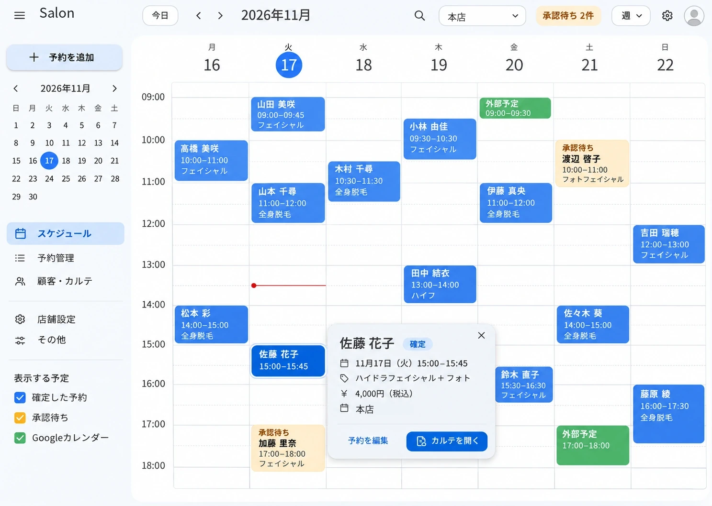
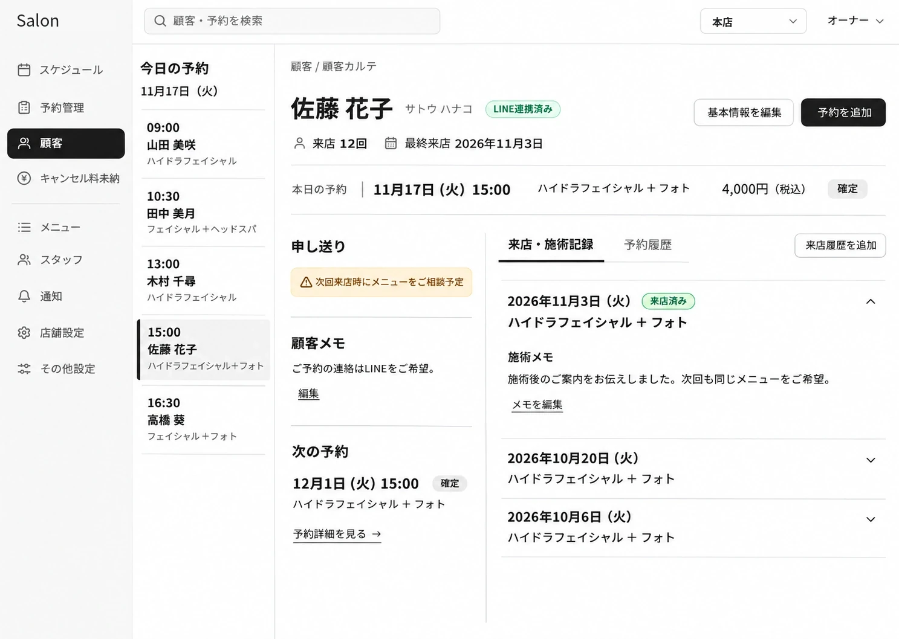

# 予約システムのデザイン基準

更新日: 2026-11-19。対象: お客様向け予約画面、管理カレンダー、予約詳細、顧客カルテ。

この文書はオーナーとのデザイン検討を具体化した目標仕様です。文書の追加時点では、画面や操作は変更されていません。現行実装との差分は[調査記録](specs/008-admin-calendar-ux/research.md)に記載します。

## 1. 目指す体験

管理画面では、Googleカレンダーを使い慣れたスタッフが、日付移動、空き時間の確認、予約の選択を迷わず行えることを基準にします。予約表から顧客カルテへ進み、記録を確認して同じ予定表の位置に戻れる構成にします。

採用する方向は、白いサイドバーのカレンダー案と顧客カルテ案の組み合わせです。その後のフィードバックに従い、管理画面の質感と配色をGoogleカレンダーのライトテーマに近づけます。スマホの指操作とMacのトラックパッド操作も、[操作仕様](specs/008-admin-calendar-ux/interactions.md)で定義します。

デザイン判断の優先順は、予約の正確さ、操作の分かりやすさ、閲覧密度、視覚的な統一です。色やジェスチャーだけを唯一の情報・操作経路にしません。

## 2. 参照画像と仕様の優先順位

### 管理カレンダーの視覚基準

画像は架空の予約データを使った生成モックです。配色の役割、画面構成、情報の優先順を参照します。画像内の料金、所要時間、予約件数、曜日設定は実データではありません。画像の文字や微細な色ムラを実装値として採用せず、本書のトークンとアクセシビリティ条件を優先します。月曜始まりは画像の設定例です。

### 顧客カルテの構造基準

この画像は情報配置の参照です。画像の旧モノトーン配色は採用せず、管理カレンダーと同じ背景、青い操作色、文字、ボタンへ統一します。氏名、来店履歴、メモはすべて架空です。

要件が食い違う場合は、最新のオーナー指示、[機能仕様](specs/008-admin-calendar-ux/spec.md)、本書、画像の順に解釈します。画像は実装済み機能やGoogle公式仕様の証拠にはなりません。

## 3. 色と質感

### 色のトークン案

以下はこのアプリ用の提案値です。Googleの非公開トークンを取得した値ではありません。実装前に組み合わせごとのコントラストを測定します。

| 意味 | ライト | ダーク | 用途 |
|---|---|---|---|
| 外側の背景 | `#F8FAFD` | `#131314` | ヘッダー、サイドバー |
| 作業面 | `#FFFFFF` | `#1E1F20` | 時間グリッド、フォーム |
| 詳細の背景 | `#F0F4F9` | `#282A2C` | 詳細（ポップオーバー、シート）の中で区切る面 |
| 本文 | `#3C4043` | `#E3E3E3` | 顧客名、項目名 |
| 補助文字 | `#5F6368` | `#C4C7C5` | 時刻、説明 |
| 主操作 | `#0B57D0` | `#A8C7FA` | 保存、カルテを開く、今日の丸 |
| 主操作上の文字 | `#FFFFFF` | `#062E6F` | 主操作のラベル |
| 選択行 | `#D3E3FD` | `#004A77` | ナビゲーションの選択 |
| 選択行の文字 | `#0842A0` | `#C2E7FF` | 選択中の項目 |
| 確定予約 | `#1A73E8` | `#A8C7FA` | 通常の予約ブロック |
| 確定予約の文字 | `#FFFFFF` | `#062E6F` | 予約名と時刻 |
| 承認待ち | `#FEF7E0` | `#FBE2A7` | 承認前の予約 |
| 承認待ちの文字 | `#7A4D00` | `#593800` | 状態ラベルと内容 |
| 外部予定 | `#137333` | `#C4EED0` | Google由来のブロック |
| 外部予定の文字 | `#FFFFFF` | `#0F5223` | 外部予定のラベル |
| 時間グリッド線 | `#DADCE0` | `#444746` | 補助的な区切り |
| 操作部品の境界 | `#747775` | `#8E918F` | 入力欄、必要な輪郭 |
| 現在時刻・エラー | `#B3261E` | `#F2B8B5` | 現在時刻線、エラー文字 |

選択中の予約は濃い青、輪郭、選択状態の読み上げで示します。承認待ちは必ず文字を併記します。外部予定は「外部予定」と管理元を示し、通常予約のような移動ハンドルを出しません。色だけで承認・来店・支払状態を区別しません。

Google連携側の既存色を取り込む場合は、カレンダーIDと色の対応を明示します。未取得の色を推測しません。文字色はコントラストに応じて決め、承認待ちや操作不可のラベルを上書きしません。初期実装の標準色は上表とし、任意色の取り込みは後続タスクです。

### 平らな面と控えめな立体感

- 背景、予定表の格子、予約、時刻、列の見出しは均一な不透明の塗りにします。装飾用のグラデーションと発光を使いません。
- ガラス（ぼかしのある半透明の面）は、画面の上に浮かぶ操作部品だけに使います（2026-11-19 オーナーが見本 A を選択）。対象は上部バー（操作と日付の見出しをまとめた 1 枚）、＋ボタン、開いた予約の詳細（ポップオーバー・シート）、開いたページ移動です。サイドバーはぼかしを使わず、ガラスに見える塗りで表します。狭い画面で引き出しとして開いている間だけは、開いた詳細と同じく `glass-modal` の面になります（後ろの画面は暗幕の下で止まっています）。
- スクロール領域の中には、ぼかしを置きません。WebKit は下の内容が動くたびにぼかしを計算し直すため、iPad の電池を消費します（#55 と `admin-app/src/components/schedule/timeline-grid.test.tsx` の回帰試験）。予定表の上に重なるぼかしは同時に 2 枚まで（上部バーと＋ボタン）とし、詳細・引き出し・ページ移動のどれかを開いた間だけ 3 枚にします。この 3 つは重ねて開きません（ページ移動を開くと引き出しは閉じます）。見本での計測は、スクロール 1 コマあたりの処理がぼかし無し 224 ms、この使い方 270 ms（+20%）、中身にもぼかしを置いた場合 1357 ms でした（WebKit のソフトウェア描画、iPad 画面サイズ。比較のための値で、iPad の実測値ではありません）。
- カレンダーの空き時間を見渡せるように、予約枠を大量の独立したカードとして装飾しません。
- 影は作成ボタン、ポップオーバー、ダイアログなど、前後関係を示す部品に限ります。
- 角丸の基準は予約4〜6px、入力欄8px、詳細20px、作業面24px、丸形操作はピル形です。
- 斜線などのパターンは、外部予定や清掃時間の識別に限って使用できます。

現在の共有トークンは `public/glass-tokens.css` です。初期段階は、この正本に新しいカレンダー専用の名前のトークンを追加し、切り替えのオン側だけで使います。既存の別名・利用側・公開予約画面の移行は、それぞれ承認を得た後の段階で行います。管理画面だけに色を直書きしたり、既存トークンを一括置換して公開予約画面を変えたりしません。light、dark、systemの設定、reduced motion、reduced transparency、contrastの扱いを維持します。

カレンダー専用のトークンは `--mg-cal-*`（ダークは `--mg-dark-cal-*`、参照名は `--mg-active-cal-*`、管理画面のユーティリティは `cal-*`）で、値は上の表のとおりです。浮かぶ部品の素材は既存の段を使います。上部バーと＋ボタンは `glass-thick`、開いた詳細の外側の面は `glass-modal` です（透明度を下げる設定とコントラストを上げる設定では不透明の面になります）。詳細の背景の色は、詳細の中で区切る面に使います。上部バーのガラスに直接載る文字は本文の色だけにします（主操作の色の塗りの上の文字は、主操作上の文字の色にします）。補助文字と主操作の色の文字は、下を流れる予約の上で 4.5:1 を下回るためです（ライトで約 3.9:1 と 4.1:1、ダークでも約 4.4:1）。主操作の色は、バーでは今日の丸などの塗り、アイコン、フォーカスの輪に限ります。バーの操作部品は文字かアイコンで見分けられるようにし、輪郭（操作部品の境界の色）だけに頼りません。輪郭はバーのガラスの上で 3:1 を下回るためです（ライトで約 2.9:1、ダークで約 2.4:1）。検索はバーに入力欄を置かず、ボタンから開きます。組み合わせごとのコントラストは `test/admin-calendar-tokens.test.ts` で確かめます。

## 4. 文字、余白、操作領域

- 本文は14〜16px、入力欄は16px以上、補助情報は12px以上です。顧客名などの要点だけを500〜600相当で強調します。
- フォントは既存の日本語表示とシステムフォントを基準にします。追加する場合は配布権と日本語の可読性を確認します。Google独自フォントの無断同梱を前提にしません。
- 余白は4、8、12、16、24、32pxを基準にします。日付や時間の桁を揃え、一覧の読み取りを優先します。
- 通常のタッチ領域は48pxを推奨し、44pxを下限とします。短い予約の表示高は所要時間に比例させ、44pxへ引き伸ばしません。重なった透明なタッチ領域で隣の予約を奪わず、一覧表示、詳細、独立した編集ハンドルで代替します。
- 通常文字は背景とのコントラスト4.5:1以上、操作を識別する輪郭やフォーカスは3:1以上を確認します。高コントラスト設定では必要なグリッド線も強めます。

## 5. 管理カレンダーの画面構成

### 広い画面

上部には今日、前後移動、年月、検索、店舗、承認待ち、表示切替を配置します。大きなページ見出しや集計カードで予定表の高さを減らしません。店舗切替は既存の権限に従います。

左側には予約追加、ミニカレンダー、主な画面への移動、表示する予定（承認待ちとGoogleカレンダーの予定の表示切替）を配置します。詳細は選択した予約の近くに開き、常設の右パネルで7日分の幅を削りません。画面端では位置を調整し、選択した予約と閉じる操作を見失わないようにします。

週表示は同じ時刻が横一列に揃う時間グリッドです。今の店舗はスタッフ指名を使わず、各店舗の予約枠（リソース）は1つです。このため予定表は1店舗を1列で見て、店舗は上部バーで切り替えます（2026-11-19 オーナー決定）。週表示は1店舗を選んで使い、同じ日の列で時間が重なる予定（予約と外部予定など）は横に並べます。全店舗を選んでいる間は、日表示で店舗ごとに列を並べ（今の日表示と同じ）、週表示を選ぶと店舗を選ぶよう案内します（2026-11-19 オーナー決定）。日表示の列は店舗です。各店舗の予約枠が1つの今は、今の日表示のリソース列と同じ見た目になります。1店舗に2つ目の予約枠を置く場合（スタッフ別など）は、予約をどの枠に入れるかとGoogleカレンダーからの取り込みの振り分けを先に決めます（別の承認）。担当リソースとスタッフ個人を同じ概念として扱いません。複数店舗を表示する場合は店舗名とリソース名を区別します。

### スマホと狭い画面

幅1024px未満（iPadの縦置きを含む）では、サイドバーを開閉できる引き出しにします（見本と同じ。今の画面は、触れて操作するiPadでは768pxから常に出しています）。640px未満では1日の時間軸と予定一覧を主な閲覧方法にします。7列の週を無理に縮めません。月表示は日付と予定数を示し、日付の選択で1日表示へ進みます。ミニカレンダーとナビゲーションは開閉できる形にします。

予約詳細は下から開くシート、顧客カルテは全幅の画面を基本にします。シート内の縦スクロールを日付移動が奪わないようにします。閉じる操作は常に用意し、未保存の入力がある場合は確認なしで破棄しません。キーボード表示、safe area、画面回転でも保存・取消操作へ到達できます。

初回表示は、広い画面が週、狭い画面が今と同じ予定一覧です。今の画面は狭い画面で予定一覧から始まり、表示の選択を保存していないため、移行できる既存の選択は表示密度だけです。利用者が選んだ日・週・月・一覧と表示密度を端末ごとに保存します。狭幅で週から日へ切り替わっても、広幅へ戻ると週の選択を復元します。見られる店舗が1つだけの場合は、その店舗を選んだ状態として扱い、全店舗の扱いや案内を出しません。全店舗を選んでいる間は、週表示になる場面（広い画面の初回、保存した週の選択の復元）を日表示にし、保存した選択は上書きしません。狭い画面の初回は全店舗でも予定一覧です。店舗を1つ選ぶと、保存した選択が週なら週へ戻ります（狭い画面では一時的に日表示のまま）。

### 予定の描画

- 00:00〜24:00を閲覧可能にし、初回は店舗の営業開始付近へ移動します。営業時間外の既存予約を隠しません。
- 日付と時刻の見出しは固定し、現在時刻線は今日の列だけに表示します。
- 予約の保存済み占有時間を正確な高さで表し、施術と清掃の境界を表示します。ラベルは施術終了と枠の解放時刻を区別します。
- 小さい予約は情報を省略しても、タップ・フォーカス・一覧で全文を確認できます。同時予約は別のレーンに配置し、上書きして隠しません。
- 休業、外部ブロック、読込失敗、予定ゼロを別の状態として示します。読込失敗や件数上限を空き時間として扱いません。
- 無効化されたリソースに既存予約がある場合も、一覧と詳細から閲覧できるようにします。
- 週は月曜から始めます（2026-11-19 オーナー決定）。日付計算は店舗タイムゾーンに従い、ブラウザやUTCの日付へ暗黙に変換しません。

## 6. 顧客カルテと予約管理

カルテは、顧客の識別情報、申し送り、今回の予約、来店・施術記録を中心にします。デスクトップでは今日の予約を左に置き、スマホでは切替リストにします。顧客を選び直した場合も、未保存の記録を黙って破棄しません。

予定表からカルテへ進む際は、店舗、表示期間、選択日、表示モード、フィルター、スクロール位置、選択予約を保持します。戻る操作で復元し、変更済み・削除済み・権限を失った予約は再取得結果に従います。古い個人情報を復元用ストレージに保存しません。

承認待ちへの入口は常設します。通知、Google同期の注意、来店状態、未納など、現在の業務上の注意を装飾の都合で隠しません。予約検索の条件や戻る操作も既存の挙動を維持します。

## 7. お客様向け予約画面

予約画面は、メニュー選択、日時選択、本人確認、確認・送信に必要な情報を順に示します。既存の3ステップと承認制、LINEの本人確認を維持します。送信後は承認待ちであることを明記し、確定と誤認させません。

メニュー選択では料金と選択済みの内容を読み取れるようにします。お客様向けの施術時間非表示を維持し、内部の所要時間・空き枠計算を変えません。日付と時間は選択・利用不可の状態を文字や形でも区別します。日付のスワイプを採用する場合も前後ボタンを用意し、管理用の予約移動やリサイズを公開画面へ持ち込みません。

フォームは16px以上、エラーは該当項目の近く、主操作は各段階で1つです。固定フッターはキーボードやsafe areaと重ならず、料金・選択内容・エラーを覆いません。

配色は、LINEへ進む操作のLINE色を含めて、今の公開画面のものを維持します（2026-11-19 オーナー決定）。揃えるのは質感・文字・部品で、管理画面の青へは置き換えません。

公開画面の変更は管理カレンダーと別の段階で、実装の前にオーナーの承認を取ってから行います。共通トークンを使っても、スタッフ用の高密度画面をお客様向けに転用しません。

## 8. 動きと操作の基準

横スライド中は指の動きに画面が追従し、離すと1期間へ移動するか元へ戻ります。縦方向の閲覧はブラウザの通常スクロールを使います。Macの慣性入力を何週もの移動として数えません。

日付移動と予約編集を別の状態として扱います。予約をなぞっただけでは変更せず、編集状態と変更候補を明示します。予約変更は確認後に保存し、通知の対象を示します。詳細は[操作仕様](specs/008-admin-calendar-ux/interactions.md)と[予約変更契約](specs/008-admin-calendar-ux/contracts/reservation-interactions.md)を参照してください。

移動アニメーションは短くし、操作中に重い再配置を起こしません。`prefers-reduced-motion`では画面全体の横移動を省略します。OSの戻る操作、ブラウザ拡大、スクリーンリーダーのジェスチャーを横取りしません。

## 9. 実装・検証文書

- [機能仕様](specs/008-admin-calendar-ux/spec.md)
- [スマホ・Mac・マウス・キーボードの操作仕様](specs/008-admin-calendar-ux/interactions.md)
- [予約変更・競合・通知・Undoの契約](specs/008-admin-calendar-ux/contracts/reservation-interactions.md)
- [実装計画](specs/008-admin-calendar-ux/plan.md)
- [実装タスク](specs/008-admin-calendar-ux/tasks.md)
- [受け入れ確認](specs/008-admin-calendar-ux/quickstart.md)
- [調査記録と一次資料](specs/008-admin-calendar-ux/research.md)
